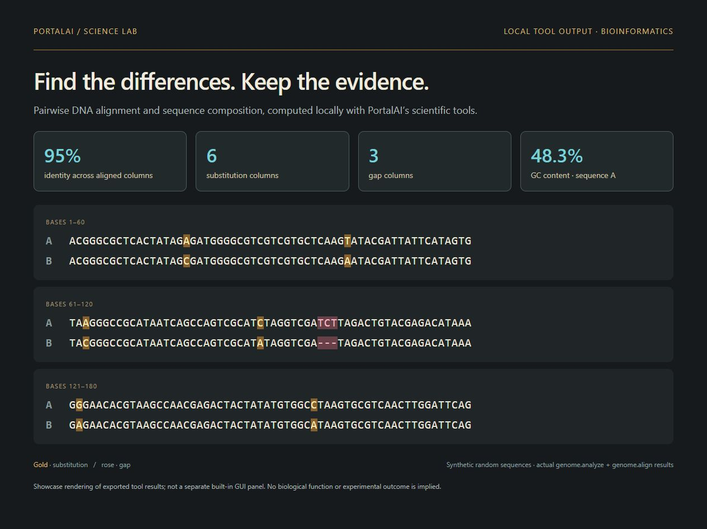
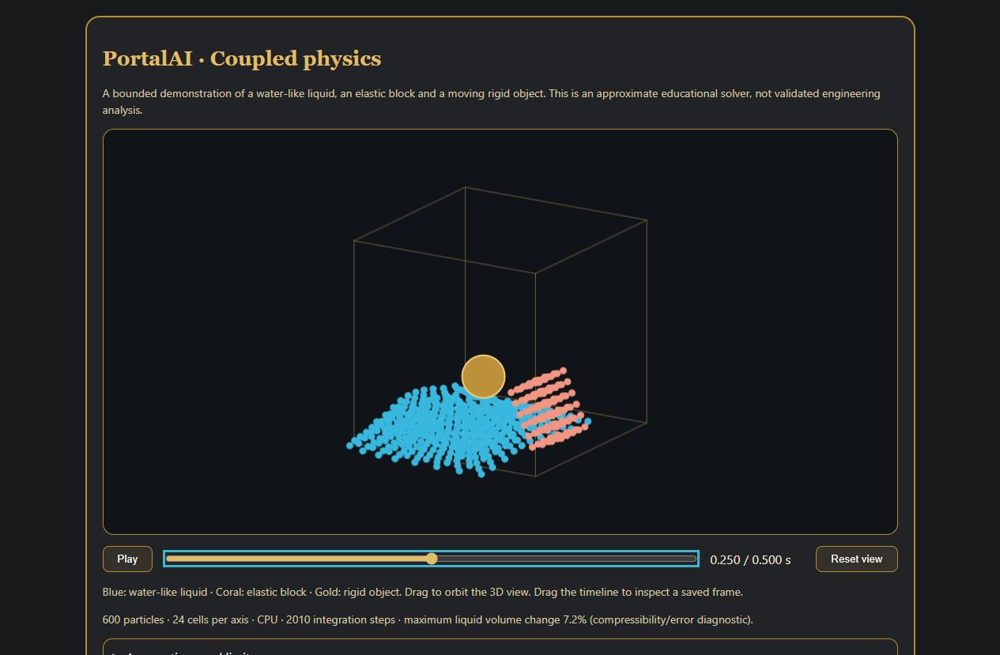

# Your workspace. Your hardware. Your drive.

PortalAI keeps the harness, selected models and projects in a local directory. A suitably fast 1TB USB drive or external SSD can carry a selected installation. Choose models to fit the drive and host; each operating system uses its own runtime and supported filesystem. Internet is needed for setup and optional online tools. Supported installed local workflows can run offline.

## Talk to Nice, then get back to work

Hands-free conversation exposes voice activity, microphone mute and an explicit end control. Compact mode keeps chat available while other applications occupy the screen.

## Fit the work to the hardware

Dynamic loading/offloading and GPU leases let supported heavy media workflows release chat VRAM, perform their work and restore chat afterward. Automatic model/backend choices and memory admission checks account for available hardware. They do not make undersized hardware sufficient for every model.

Academic enforces standard-only models and disables the Full-only abliterated coding specialist.

## Keep work moving across sessions

Persistent missions retain objectives, access settings, review history and bounded action budgets. Schedules are explicitly enabled; Stop/Exit pauses future work. Execution needs PortalAI running, an awake host and the drive connected. Rolling memory compaction keeps working notes and searchable transcripts available for long tasks.

## Understand and maintain the installation

The Help menu provides 67 searchable operating topics. Maintenance brings diagnostics, storage audits, reserves, duplicate scans and repair controls into one place. The [web guides](https://payhip.com/PortalAI/help-maintenance) mirror the Full r72 help; Academic edition restrictions still apply.

## Keep the workspace personal

Local accounts use password-derived keys and authenticated encryption for stored profile keys and sealed user workspaces. Files are decrypted during use and sealed on normal Exit. Guest is shared, and this is not isolation from the signed-in OS user. Dark mode changes the palette without changing the workflow.

## Science with inspectable results

The bioinformatics example below uses actual `genome.analyze` and `genome.align` output on synthetic random sequences: 180 alignment columns, 171 matches, six substitutions and three gap columns. The visual is a showcase rendering of exported results, not a separate built-in GUI panel. It makes no claim about biological function.

The actual coupled-physics viewer shows a 600-particle 3D demonstration at 0.250 seconds. Water-like liquid, an elastic block and a moving rigid object are integrated locally on the CPU. This is an approximate educational solver, not validated engineering analysis; the displayed volume-change diagnostic is about 7.2%.

## More interface controls

Right-click a control for context-specific actions and its Help topic. Runtime presents CPU, RAM, GPU and VRAM activity; Packages offers a searchable capability inventory. Model, backend and media choices still pass hardware and memory admission checks.

On Windows, Controls > Minimize to tray hides the window while work continues. The notification icon restores it and offers navigation, theme and lifecycle actions. Minimizing does not sign out, seal the workspace or stop jobs; use Exit PortalAI for normal shutdown. If a tray icon cannot be created, PortalAI falls back to the taskbar. Native Mac/Linux behavior differs.

## Explore by task

- [Chat & Voice](https://payhip.com/PortalAI/chat-voice)
- [Models & Runtime](https://payhip.com/PortalAI/models-runtime)
- [Media Studio](https://payhip.com/PortalAI/media-studio)
- [Science Lab](https://payhip.com/PortalAI/science-lab)
- [Workspace and persistence](https://payhip.com/PortalAI/workspace)
- [Help & Maintenance](https://payhip.com/PortalAI/help-maintenance)

These web guides describe Full r72 on Windows. OS-specific availability and Academic restrictions remain in effect. [Capture provenance](assets/README.md).
