# Your workspace. Your hardware. Your drive.

PortalAI keeps the harness, selected models and projects in a local directory. A suitably fast 1TB USB drive or external SSD can carry a selected installation. Choose models to fit the drive and host; each operating system uses its own runtime and supported filesystem. Internet is needed for setup and optional online tools. Supported installed local workflows can run offline.

[Explore the main tabs, subtabs, account controls and context menus](GUI-PREVIEWS.md).

## Talk to Nice, then get back to work

Hands-free conversation exposes voice activity, microphone mute and an explicit end control. Compact mode keeps chat available while other applications occupy the screen.

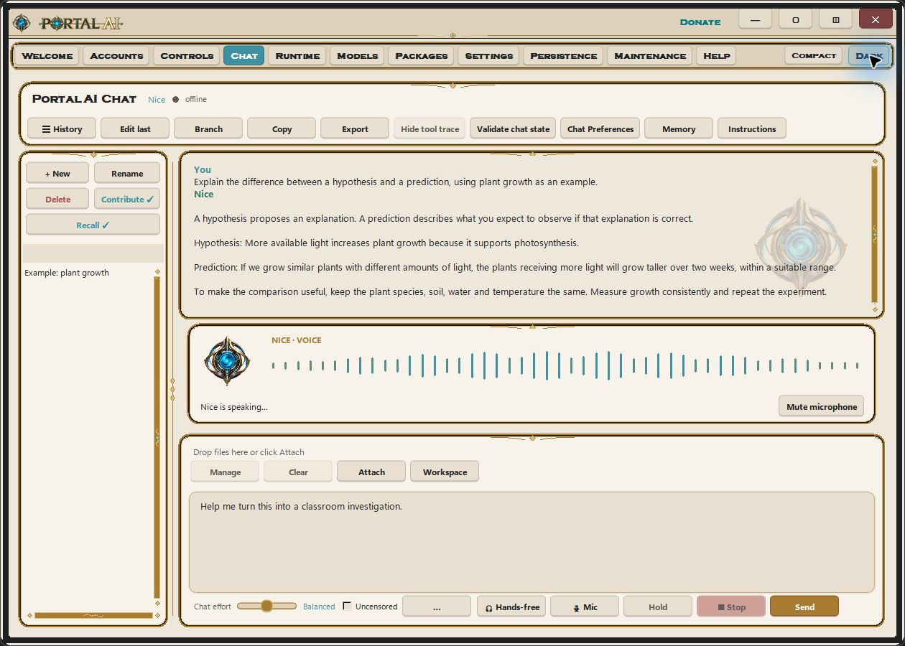

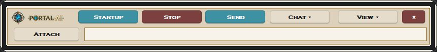

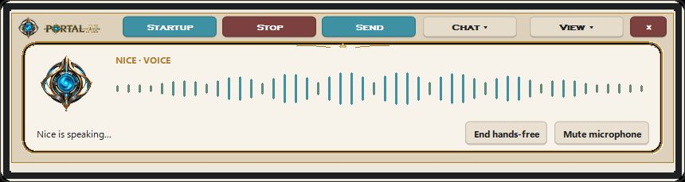

## Fit the work to the hardware

Dynamic loading/offloading and GPU leases let supported heavy media workflows release chat VRAM, perform their work and restore chat afterward. Automatic model/backend choices and memory admission checks account for available hardware. They do not make undersized hardware sufficient for every model.

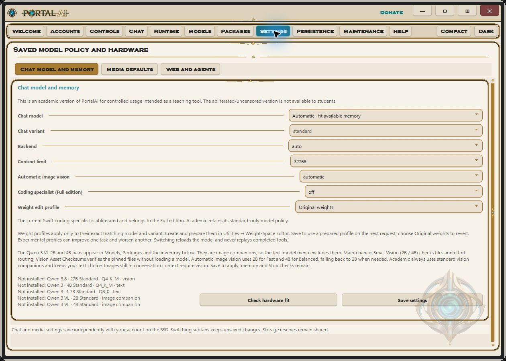

Academic enforces standard-only models and disables the Full-only abliterated coding specialist.

## Keep work moving across sessions

Persistent missions retain objectives, access settings, review history and bounded action budgets. Schedules are explicitly enabled; Stop/Exit pauses future work. Execution needs PortalAI running, an awake host and the drive connected. Rolling memory compaction keeps working notes and searchable transcripts available for long tasks.

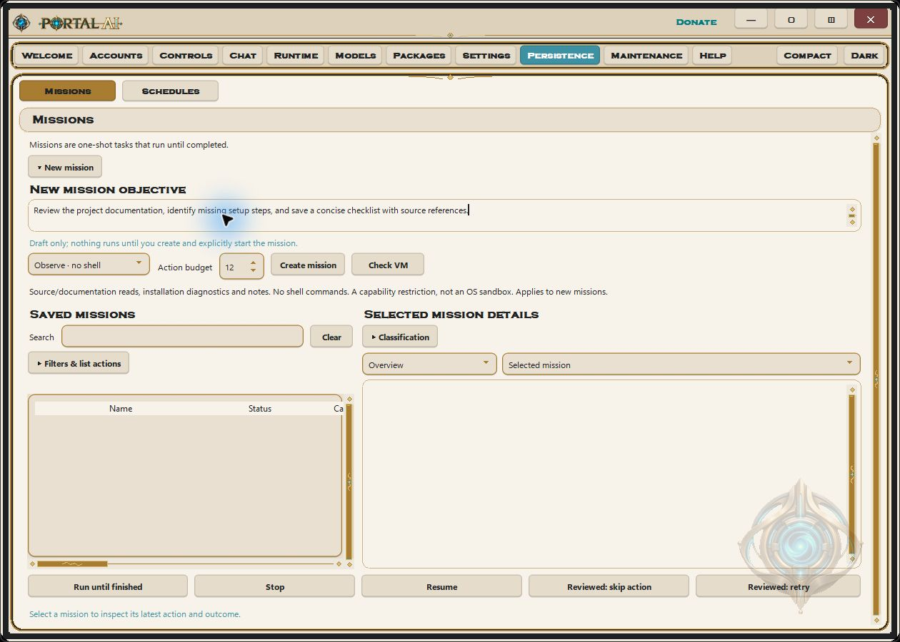

## Understand and maintain the installation

The Help menu provides 67 searchable operating topics. Maintenance brings diagnostics, storage audits, reserves, duplicate scans and repair controls into one place. The [web guides](https://payhip.com/PortalAI/help) mirror the Full r72 help; Academic edition restrictions still apply.

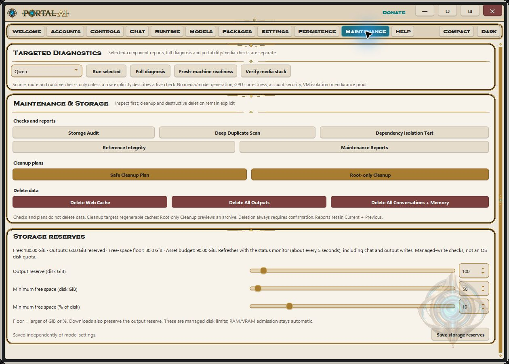

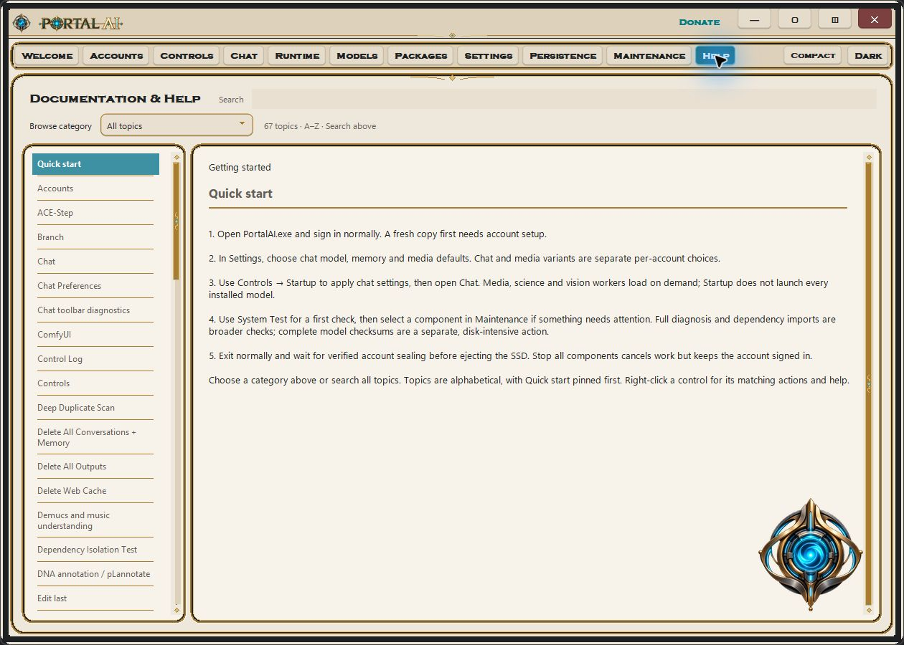

## Keep the workspace personal

Local accounts use password-derived keys and authenticated encryption for stored profile keys and sealed user workspaces. Files are decrypted during use and sealed on normal Exit. Guest is shared, and this is not isolation from the signed-in OS user. Dark mode changes the palette without changing the workflow.

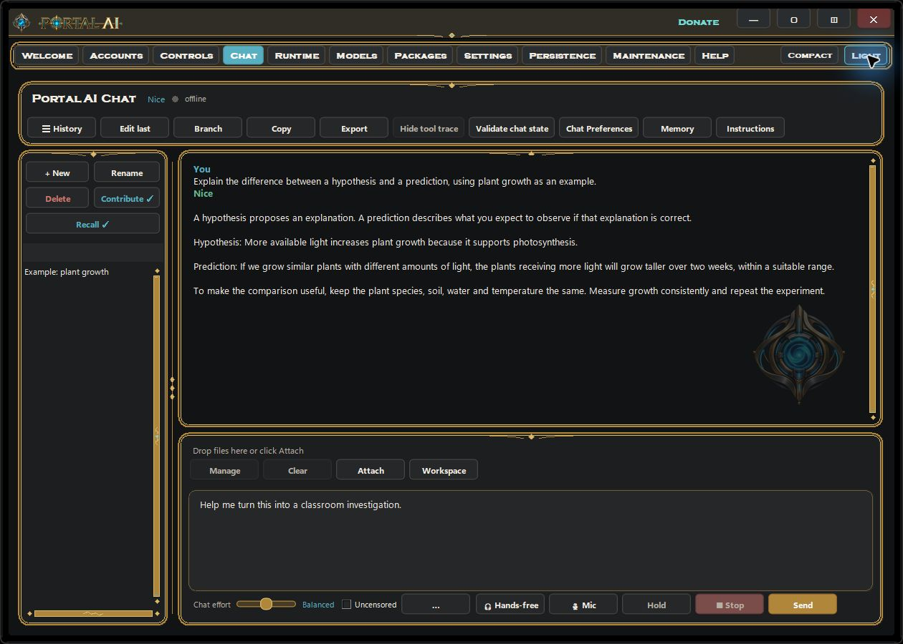

## Science, through Nice

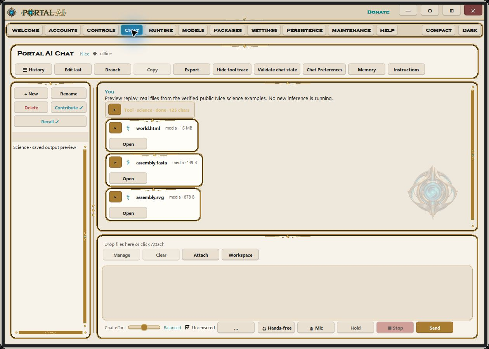

The card preview replays exact files from the recorded Nice runs. Click Open to reach the output viewers shown below.

These examples were executed through Nice in the Windows Chat interface. They are generated output files, not extra built-in PortalAI tabs. We supplied explicit parameters, corrected an invalid physics input, and verified the actual tool returns and files. [Exact prompts, outputs and provenance](science-examples/README.md).

Ask Nice to load the science tool, run an operation and return its outputs. In r73, use **Open** on the returned file card, or find the output through **Workspace**. HTML scenes open in your browser, SVG files in a compatible viewer, and CAD files in suitable CAD/mesh software. Scientific tools require an administrator account.

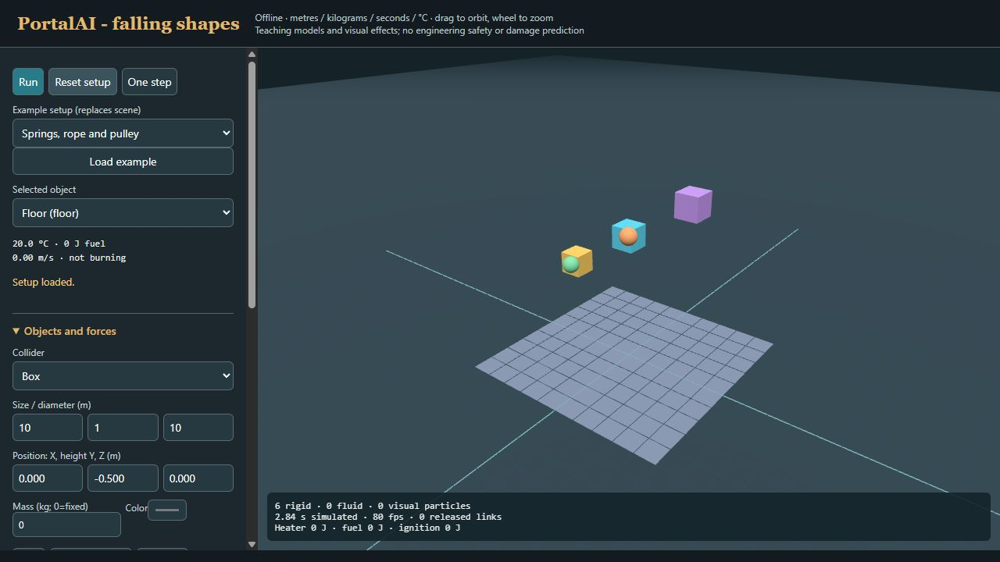

**Physics:** a fixed floor, three boxes and two spheres, generated with `physics.world`. Run/Pause, Reset and object controls belong to the actual output viewer. This bounded educational simulation uses approximate collisions and materials; it is not validated engineering analysis.

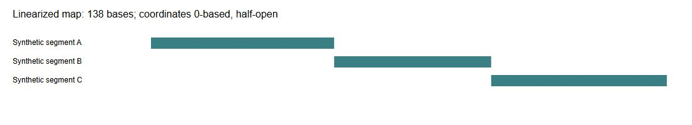

**Bioinformatics:** three supplied arbitrary synthetic segments joined into a 138-base sequence with `plasmid.assemble` and `annotated_join`. The SVG feature map accompanies GenBank and FASTA exports. Labels and reverse-strand placement are supplied input; no biological function or experimental assembly is implied. Other operations support sequence analysis, translation, alignment and reference annotation.

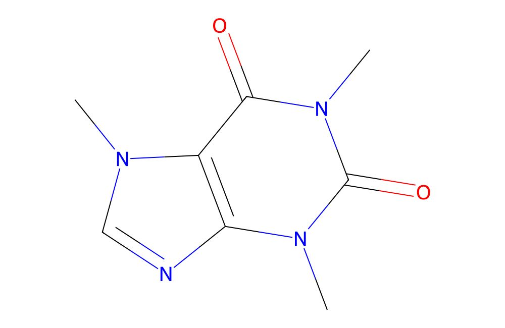

**Chemistry:** `chem.render` drew the supplied caffeine SMILES string and reported C8H10N4O2, molecular weight 194.194. This is a computed diagram. Conformer generation is also available; it does not provide an experimentally measured structure.

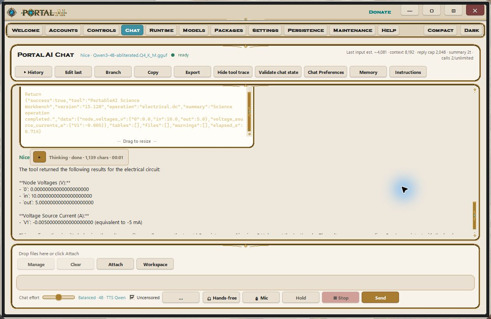

**Circuits:** The request supplied an ideal 10 V source, R1 = 1 kΩ from input to output and R2 = 1 kΩ from output to ground, with no output load, and asked for node voltages and current. Nice called `electrical.dc` for a 10 V source and two 1 kΩ resistors. The actual solver returned a 5 V midpoint and −0.005 A source current under its sign convention. Supported ideal DC circuits and RC responses are calculations, not a schematic editor or hardware measurement.

**3D modeling:** Nice generated actual STEP and STL files using `cad.model`: a nominal 40 × 30 × 5 mm plate with a radius-4 mm cylindrical cut. Supported primitive add/cut/intersect operations create editable/exportable geometry. Inspect dimensions and tolerances in a CAD viewer before manufacturing; the reported bounds include kernel tolerances.

The pictured runs used Full on Windows. Shared science functionality is subject to each edition's restrictions and installed components. Linux needs supported optional science packages; the initial Mac package omits the optional science runtime. Physical Mac/Linux execution was not tested here. Models can misstate completion: check the tool return and saved output.

## More interface controls

Right-click a control for context-specific actions and its Help topic. Runtime presents CPU, RAM, GPU and VRAM activity; Packages offers a searchable capability inventory. Model, backend and media choices still pass hardware and memory admission checks.

On Windows, Controls > Minimize to tray hides the window while work continues. The notification icon restores it and offers navigation, theme and lifecycle actions. Minimizing does not sign out, seal the workspace or stop jobs; use Exit PortalAI for normal shutdown. If a tray icon cannot be created, PortalAI falls back to the taskbar. Native Mac/Linux behavior differs.

## Explore by task

- [Chat & Voice](https://payhip.com/PortalAI/chat-voice)
- [Models](https://payhip.com/PortalAI/models-runtime)
- [Media Studio](https://payhip.com/PortalAI/media-studio)
- [Science examples in Chat](https://payhip.com/PortalAI/chat-voice)
- [Workspace and persistence](https://payhip.com/PortalAI/workspace)
- [Help](https://payhip.com/PortalAI/help)

These web guides describe Full r72 on Windows. OS-specific availability and Academic restrictions remain in effect. [Capture provenance](assets/README.md).

[The full 138-base DNA sequence, exact circuit problem and additional science/engineering capabilities](science-examples/README.md).
