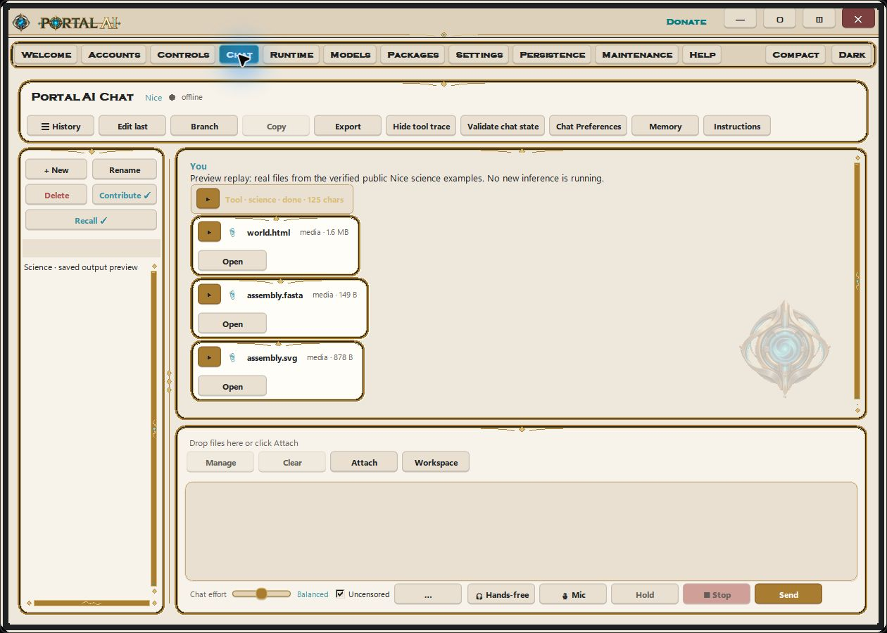
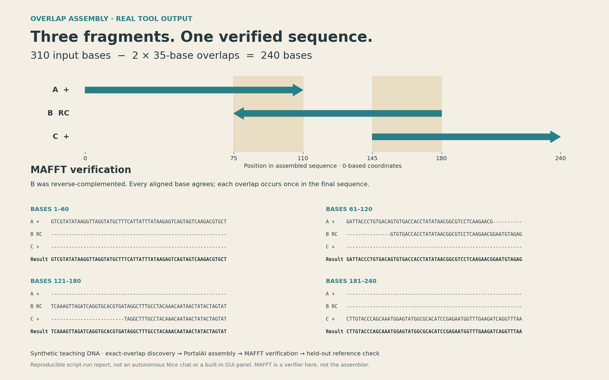
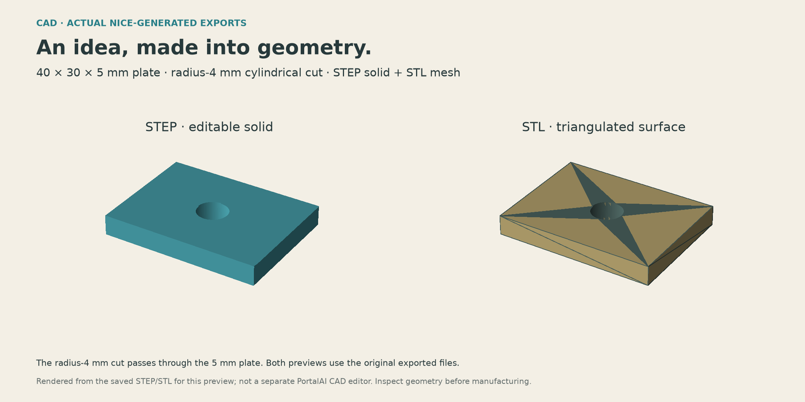

# Actual science examples, 8 November 2026

The original examples were generated by Nice through PortalAI Full's native Windows Chat, using the installed balanced local chat model and the repaired science dispatcher. The screenshots show actual opened files (physics, biology, chemistry) and the real circuit tool return in Chat. No dashboard was fabricated for these images. The earlier showcase composites have been superseded.

The included prompt files are the explicit inputs used for the successful individual calls. The physics prompt corrects an earlier oversized floor. An earlier multi-operation attempt was rejected because the model claimed results without executing the requested tools; none of those claims are used here. Individual chemistry, CAD and circuit calls then returned real successful tool results. This is a reproducible guided demonstration, not a claim that every natural-language request succeeds on the first attempt.

Open `world.html` from a new physics run in a browser. The supplied `physics/scene.json` records the scene. Biology's SVG/GenBank/FASTA, chemistry's SVG and CAD's STEP/STL are exact generated output bytes. The circuit tool returned ground 0 V, input 10 V, midpoint 5 V and source current −0.005 A. CAD's reported bounding dimensions include numerical/kernel tolerance. Outputs use arbitrary teaching inputs; no private account history is included.

Physics was run and paused in its actual browser viewer, then reset to show the initial arrangement. It uses bounded educational approximations. The biology labels describe supplied segments, not inferred biological function. Chemistry is computed structure depiction. Circuit values solve an ideal model. Native CAD viewing and physical Mac/Linux execution were not part of these captures.

To reproduce: sign in to an administrator account, open Chat, supply one prompt, inspect the science tool return, and open its returned output. Install the relevant optional packages first. Model choices may require correction; actual output files are the evidence. The initial Mac distribution omits the optional science runtime.

## Start in Chat, then open the outputs

This capture replays the exact previously generated public files through PortalAI's real Chat card renderer; it is not a new inference run. Click **Open** on a card to open its file in a compatible viewer. The opened-output screenshots in the feature tour show those separate viewers, not hidden science dashboard tabs.

## Updated DNA overlap example

Three shuffled fragments, one reverse-complemented: **310 supplied bases → two 35-base overlaps removed → one verified 240-base sequence**. [Exact inputs, MAFFT alignment, executable workflow, outputs and limitations](biology-overlap/README.md).

This replacement is a verified **script-run** example using PortalAI's existing assembly function and separately installed MAFFT. It is not a newly completed Nice chat or new GUI panel. The original 138-base concatenation files and prompt remain under `biology/` as historical provenance, but are no longer the featured assembly example.

## STEP and STL previews

The [actual CAD prompt](cad-prompt.txt) requested a 40 × 30 × 5 mm plate and a radius-4 mm cylindrical cut. The saved [STEP](cad/demo-plate.step) and [STL](cad/demo-plate.stl) contain a through-hole: the actual plate spans z = 0..5 mm. The two images are rendered directly from those original files, not a recreated shape or a PortalAI editor screenshot. The STEP solid passes validity checks; its 5748.6726 mm³ volume matches 40 × 30 × 5 − π × 4² × 5. The STL contains 520 triangles and has matching nominal extents. [Geometry checks and original-file hashes](cad/preview-validation.json).

The original numerical bounding-box return included kernel tolerances. This preview validates the saved geometry independently; it does not certify manufacturability.

## What the voltage-divider example solved

The supplied problem was: connect an ideal **10 V** source between input and ground, **R1 = 1 kΩ** from input to output, and **R2 = 1 kΩ** from output to ground, with **no output load**. Find the output voltage and current.

Nice called `electrical.dc` with those components. The solver returned **5 V at the output**. The series current is **10 V / (1 kΩ + 1 kΩ) = 5 mA**; the source reports **−0.005 A** because it delivers current under the solver's sign convention. This is an ideal DC calculation, not a measured circuit or a schematic-editor screenshot.

## …and more

Depending on edition, platform and installed optional packages, the science tools also cover table analysis and plotting, sequence translation/alignment/reference annotation, genome specificity, protein-interface analysis, chemical screening, binding fits and docking, scientific-paper context, CAD modeling and STEP/STL exports, print preparation and slicing, mechanical integrity estimates, SPICE/board calculations and projectile motion with drag. Outputs and assumptions need review; package presence alone does not validate a scientific conclusion.
