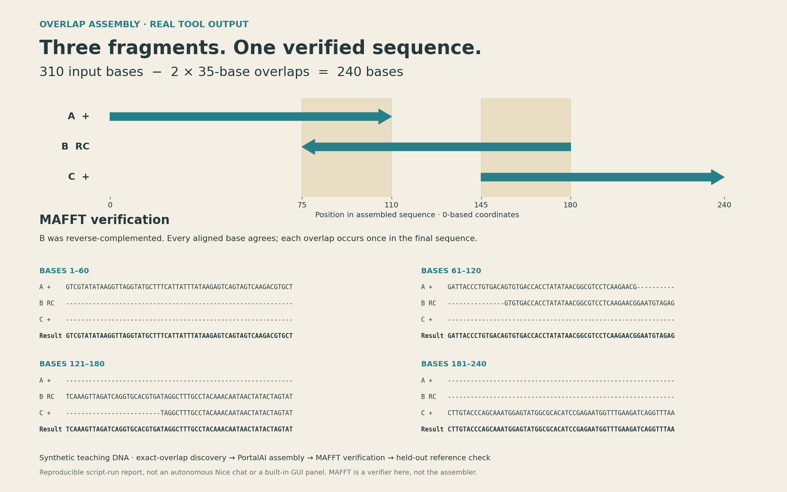

# Overlapping DNA fragments, with MAFFT verification

The earlier example only concatenated ordered fragments. This replacement solves an explicit ordering/orientation problem and removes repeated overlap sequence.

## Task and actual result

Given `fragments.fasta` in the order **A, C, B**, recover a linear sequence. The input includes **A: 110 bases**, **C: 95 bases**, and **B: 105 bases supplied in reverse-complement orientation**. The script receives no order or overlap lengths. A is only the strand anchor: whole-sequence reverse complementation would otherwise be equally valid.

It enumerates fragment order and strand choices, requiring exact suffix/prefix overlaps of at least 20 bases, and refuses ambiguous/disconnected solutions. For this fixture there is one anchored solution: **A → reverse-complement(B) → C**, with **35-base overlaps** at each junction. The unmodified PortalAI `Scientific.biology.assemble` implementation receives those discovered junctions in `method="overlap"` mode and exports FASTA, GenBank and SVG.

**310 input bases − 70 duplicated overlap bases = 240 output bases.** MAFFT 7.526 `--addfragments --keeplength` aligns all three oriented fragments to the recovered assembly. Checks require every fragment base to be retained, each fragment to occupy a contiguous interval, and every occupied alignment position to agree. The assembled sequence is then compared to `expected.fasta`, a held-out reference that is not read until after assembly/alignment. It matches exactly.



## What was actually run

This is a reproducible script-run example using PortalAI's existing biology function plus the official Windows MAFFT package. It is **not a newly completed autonomous Nice chat** and the image is a scientific report rendered from real outputs, **not a built-in PortalAI GUI panel**. Order/orientation discovery lives in the supplied example script; it is not advertised as an added built-in operation. No application code or installer was changed.

A direct MAFFT direction-adjusted multiple alignment of these short partially overlapping fragments did not recover the correct layout. We did not present that as a successful assembly. MAFFT is an aligner, and here it checks fragments against an independently recovered scaffold; the held-out reference check is the additional correctness evidence. This small exact-match fixture does not establish robustness to repeats, sequencing errors, ambiguous bases or biological function. It uses arbitrary seeded teaching DNA, not a designed biological construct. GenBank here is an export format; no database lookup was performed.

MAFFT documentation: [adding fragments](https://mafft.cbrc.jp/alignment/software/addsequences.html), [strand adjustment](https://mafft.cbrc.jp/alignment/software/adjustdirection.html), [official Windows distribution](https://mafft.cbrc.jp/alignment/software/windows_without_cygwin.html). Tested package: `mafft-7.526-win64-signed.zip`, SHA-256 `7c3a508c8512af04007d68019c6fbd4ff00d891244b58f87ec9aa0e53fbae8a7` (recorded download digest, not a vendor-published signature assertion). MAFFT itself is not included here.

## Reproduce

Use PortalAI's Python with Biopython installed and an official MAFFT installation. Copy this example directory to a writable workspace. Supply the PortalAI root and MAFFT launcher paths; all generated files stay in the example directory:

```text
python build_example.py --portalai-root "PATH/TO/PortalAI" --mafft "PATH/TO/mafft.bat"
```

On a non-Windows system use the native `mafft` executable path. Physical Linux/Mac execution of this example has not been verified. To regenerate the report image, run `render_alignment.py` in a separate plotting environment with matplotlib. The scientific output does not require that plot.

The saved `validation.json` records orientation, intervals and checks. `assembly-request.json` can also be supplied to PortalAI's existing `plasmid.assemble` tool once the overlaps have been determined; that alone reproduces assembly/export, not overlap discovery or MAFFT verification.

## Final sequence

```fasta
>assembly
GTCGTATATAAGGTTAGGTATGCTTTCATTATTTATAAGAGTCAGTAGTCAAGACGTGCTGATTACCCTGTGACAGTGTGACCACCTATATAACGGCGTCCTCAAGAACGGAATGTAGAGTCAAAGTTAGATCAGGTGCACGTGATAGGCTTTGCCTACAAACAATAACTATACTAGTATCTTGTACCCAGCAAATGGAGTATGGCGCACATCCGAGAATGGTTTGAAGATCAGGTTTAA
```
