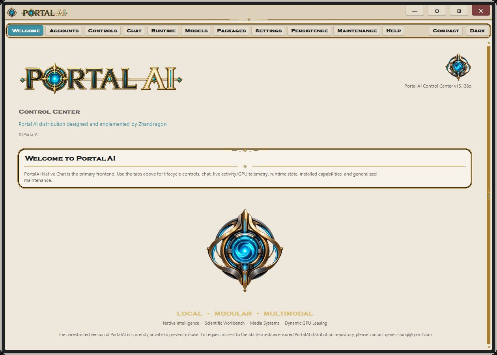
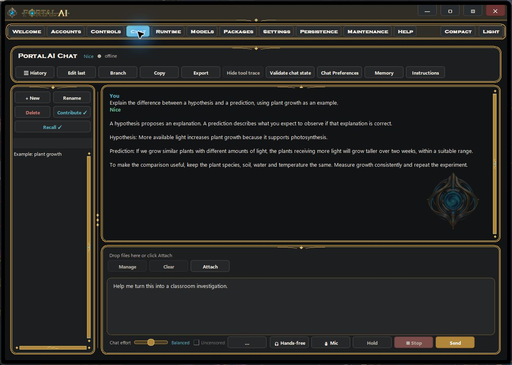
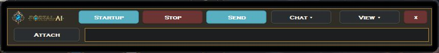
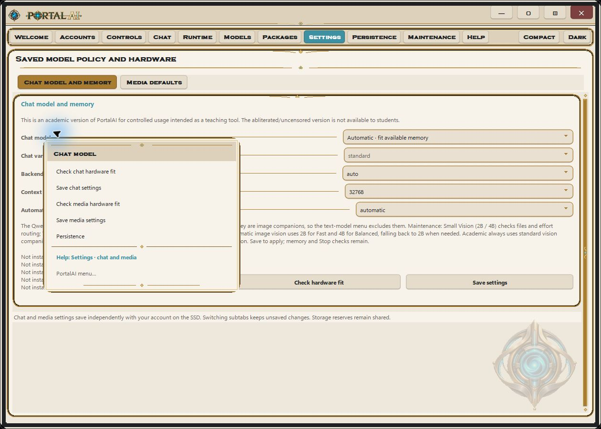
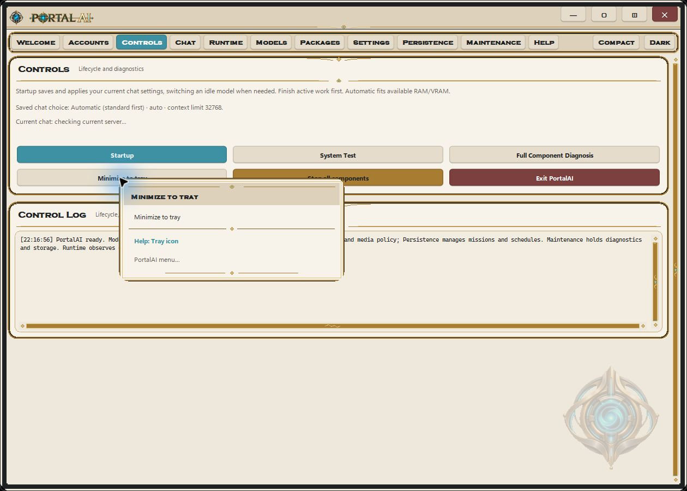
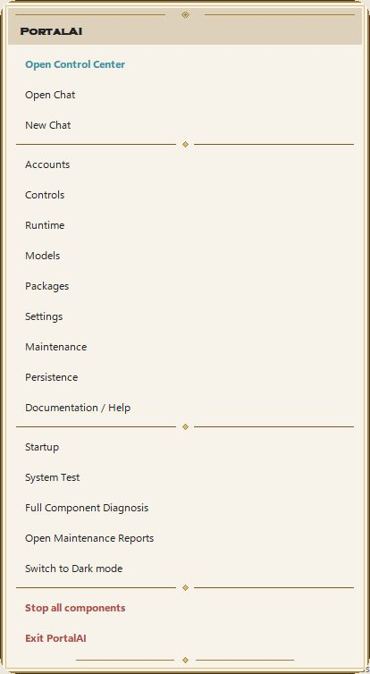
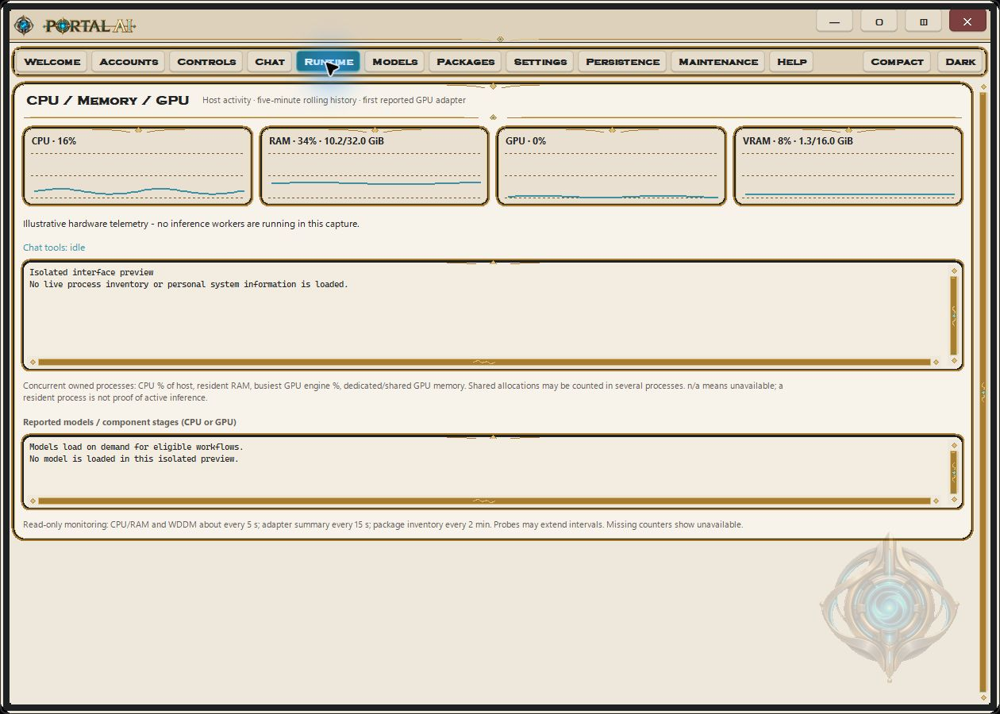
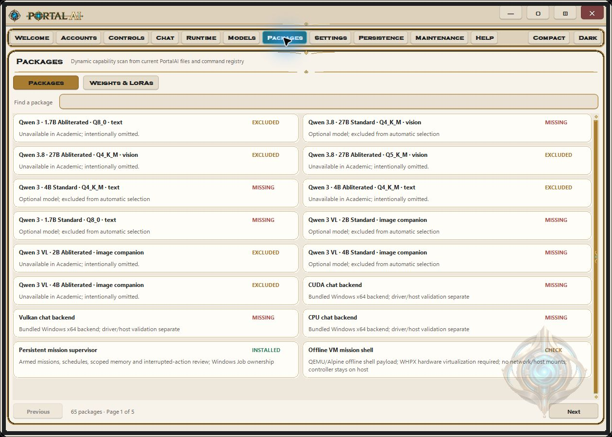
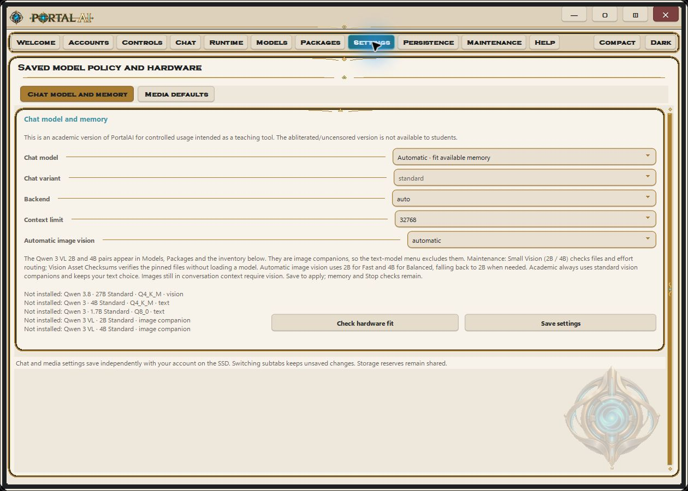
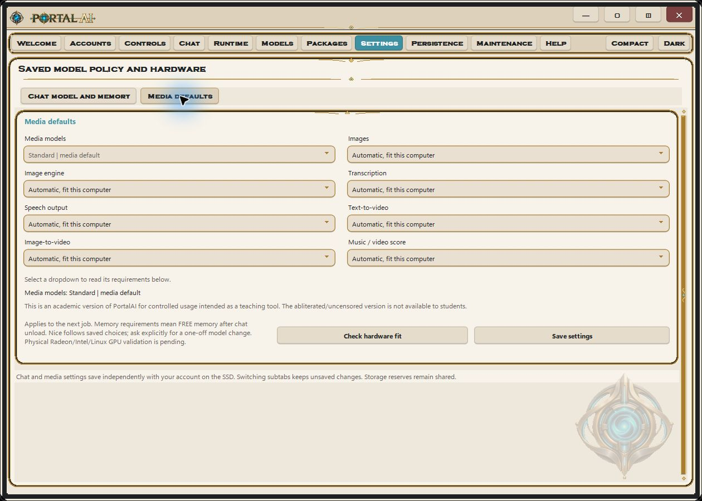

<p align="center">
  
  &nbsp;&nbsp;
  
</p>

<h1 align="center">PortalAI</h1>

<p align="center"><sub>(Academic)</sub></p>

<p align="center"><strong>Local AI for guided learning and classroom exploration.</strong></p>

<p align="center">
  <a href="#download-and-install">Download</a> &nbsp;·&nbsp;
  <a href="#a-look-inside">Interface gallery</a> &nbsp;·&nbsp;
  <a href="#built-in-help-and-documentation">Help</a> &nbsp;·&nbsp;
  <a href="#projection-and-home-assistant">Projection / Home Assistant</a> &nbsp;·&nbsp;
  <a href="#companion-utilities">Utilities</a> &nbsp;·&nbsp;
  <a href="Documentation/README.md">Documentation</a>
</p>

**Welcome to PortalAI:** a portable workspace for local chat, tools, science, images, video, speech and music.

<p align="center"><a href="https://github.com/sponsors/Zhandragon"></a><br/><sub>Support continued PortalAI development · <a href="Documentation/DONATIONS.md">Donation options</a></sub></p>

> This is an academic version of PortalAI for controlled usage intended as a teaching tool. The abliterated/uncensored version is not available to students.

The Academic edition keeps PortalAI's main interface and supported workflows, with standard/censored chat, vision and media enforced. Variant controls remain visible but inert, excluded model and LoRA assets are not downloaded, and an Academic instruction appendix is applied to the chat and mission harnesses.

**Unrestricted distribution — by special request and approval only.**

The unrestricted version of PortalAI is currently private to prevent misuse. To request access to the abliterated/uncensored PortalAI distribution repository, please contact genesislung@gmail.com

> **Platform testing disclaimer:** Only Windows has been thoroughly tested. Linux has received partial validation; macOS and other operating systems have not been thoroughly tested. Installation may fail or other errors may occur on these platforms. Please [report problems to the maintainer](https://github.com/Zhandragon/PortalAI-Academic/issues), including your operating system version and the error message. Packaging checks are not fresh end-to-end inference tests on all three operating systems.

**PortalAI runs its AI locally on your computer.** Models, inference, supported tools, conversation history and account storage live on your own host and drive; core use requires no hosted AI service or cloud API key. After the required components are installed, supported local workflows can run offline. Installation and model downloads need internet access, and optional web tools and Home Assistant projection use the network you choose. Remote projection sends interface data through your Home Assistant connection while AI inference stays on the PortalAI host.

- **Dynamic VRAM loading and offloading.** Models and media workers load on demand. Memory admission checks and exclusive GPU leases let supported heavy workflows release the chat model's VRAM, run their work, then restore chat. Model/backend choices account for available hardware; this manages limited memory rather than removing hardware requirements.
- **Rolling memory compaction.** Long tasks checkpoint completed tool exchanges into compact working notes while keeping the current request, recent complete exchanges and important results and file paths. The retained transcript can be searched for exact details, helping work continue beyond one context window without pretending everything remains in active context.
- **Persistent missions and schedules.** Save an objective, access settings and an action budget, or configure scheduled work. Missions must be armed and schedules enabled explicitly; Stop/Exit pauses future work. Execution needs PortalAI running, an awake host and the drive connected.
- **A compact tool and multimedia harness.** Short default instructions, targeted tool schemas and runtime-managed media steps reduce repeated catalog searches and model deliberation. The harness handles details such as media timing and frame calculations and carries results forward through compaction. This is designed to reduce planning overhead; performance still depends on the model and workflow.
- **Stall recovery and bounded thinking/tool cycles.** Enabled by default, PortalAI's chat harness breaks stalled coding and long research, media or science workflows into short cycles of planning, action and review. After the configured delay and enough tool interactions, it limits repeated inspection and directs the model toward one grounded edit, supported finding or authorized operation, then returns to normal exploration and review. This enforces chunking of planning and tool use between completed responses/tool calls; it cannot interrupt an ongoing reasoning response or tool job. Configure both aids and their delay in **Chat Preferences > Tools & limits**. [Behavior, defaults and limits](Documentation/Task_Progress_r51.txt).
- **Local accounts and encrypted user vaults.** Password-protected accounts use password-derived keys and authenticated encryption for stored profile keys and sealed user workspaces. Workspace files are decrypted while an account is in use; normal Exit seals them again. Guest is a shared/public workspace, and encryption is not isolation from the signed-in operating-system user.
- **Context-aware help and a nonintrusive interface.** Right-click controls for relevant actions and built-in help. Switch between the full workspace and Compact chat, or keep PortalAI reachable through the Windows notification icon while the window is hidden.


**New: web tools, collaborating agents, configurable ports and Mac Projection.** See the [feature update](Documentation/UPDATE-20261021.md). Full and Academic installers keep separate model policies.

**Mission review instructions.** Add corrections or responses to a paused mission or scheduled run, retain review history, and re-enable reviewed schedules. [Details and current installers](Documentation/MISSION-REVIEW-20261022.md).


**Latest update (2026-10-29 r51):** Detected coding requests now receive automatic bounded implementation assistance. Other long tool workflows periodically consolidate evidence and take one justified next step. Both aids have independent opt-outs; existing execution checks and job parameters remain in force. [Changes and validation](Documentation/RELEASE-r51.txt).

**Previous update (2026-10-28 r50):** Optional coding stall recovery alternates a bounded implementation burst with review and testing. File receipts distinguish changed bytes from no-op writes. [Changes and validation](Documentation/RELEASE-r50.txt).

**Previous update (2026-10-27 r49):** Improved code navigation: ranked source discovery, own-install paths, exact symbol locations and compact context that preserves search evidence. [Changes and validation](Documentation/RELEASE-r49.txt).

**Previous update (2026-10-27 r48):** Expanded website, in-site and database search; structured data and media discovery; source maps and optional guidance for 1.7B/4B. [Changes and validation](Documentation/RELEASE-r48.txt).

**Previous update (2026-10-27 r47):** Unified Utilities and Login recovery/reset controls; optional suite downloads; observed environment, source search and focused coding tools. [Changes and validation](Documentation/RELEASE-r47.txt).

**Previous update (2026-10-25 r45):** Unified application fixes, version-aware upgrades, account recovery, and a fourth universal setup option. [Changes, upgrade instructions and validation](Documentation/UNIFIED-20261025-r45.md).

**Web-search update (2026-10-24 r16):** Native web search and saved source evidence are repaired. Search results retain links and snippets; help is clearly distinguished from findings. Existing account guards, Academic policy and UI styling are preserved. [Changes and validation](Documentation/WEB-SEARCH-20261024-r16.md).

**Refresh update (2026-10-24 r15):** Mission and schedule views refresh in the background, hidden pages stop polling, and Runtime avoids loading dormant histories. Account/Stop protections and the latest Donate styling are preserved. [Changes and validation](Documentation/REFRESH-REPAIR-20261024-r15.md).

**Donation update (2026-10-24 r14):** The turquoise **Donate** title-bar link now uses PortalAI's display lettering without an underline. Rounded gold donation cards and tighter spacing keep the entire page visible at the default window size; smaller windows still scroll. QR data and destinations are unchanged. [Changes and validation](Documentation/DONATION-POLISH-20261024-r14.md).

**First-launch update (2026-10-24 r11):** Fixes fresh installations incorrectly asking for an existing administrator. First launch now offers **Create initial administrator**; existing account recovery protections remain. [Changes and validation](Documentation/FIRST-LAUNCH-20261024-r11.md).

**Shutdown update (2026-10-24 r10):** Fixes shutdown after lazy file restoration is paused, retains visible failure details with a stopped timer, and adds themed confirmation for deleting saved Projection connections. The temporary Aoostar mission importer stays excluded. [Changes and validation](Documentation/SHUTDOWN-20261024-r10.md).

**Interface update (2026-10-24 r7):** Right-click actions for missions and schedules, confirmations inside PortalAI, polished Projection borders/themes, and current-download plus overall installer progress. [Changes and validation](Documentation/INTERFACE-INSTALLER-20261024-r7.md).

**Archive fix (2026-10-24 r6):** Fixed the Windows installer’s “Archive links are not supported” failure. Missions and schedules now include search, sortable lists, clearer review summaries, optional autonomous recovery, and a more compact layout; Windows taskbar icons use the existing detailed artwork. [Details and validation](Documentation/INSTALLER-HANDOFF-20261024.md).

**Mission planning update (2026-10-22 r5):** Missions receive explicit completed results and scheduled-run context, correct repeated or malformed proposals before execution, and show actual reasoning in Live activity. Use the standard 4B model or a more capable installed model for conditional recurring work: 1.7B did not reliably pass the memory/scheduling test. [Details, validation and limits](Documentation/MISSION-PLANNING-20261022.md).

## Download and install

### Hardware and software dependencies

**Windows NVIDIA image/video generation requires CUDA 13 compatibility.** The supplied ComfyUI runtime uses **CUDA 13.0**: install an **NVIDIA R580 or newer driver** that supports your GPU, and use a GPU supported by the supplied PyTorch runtime. See [NVIDIA's driver compatibility requirements](https://docs.nvidia.com/deploy/cuda-compatibility/minor-version-compatibility.html) and [official driver downloads](https://www.nvidia.com/Download/index.aspx). Other Windows media components use CUDA 12.8; the CUDA 13 requirement applies to the current ComfyUI GPU path.

| Platform or feature | Dependencies you provide |
| --- | --- |
| Windows x64 | .NET Framework 4.5 or later (included in Windows 10/11); a compatible graphics driver for GPU acceleration. For NVIDIA image/video generation, meet the CUDA 13 requirement above. |
| Linux x86-64 | glibc 2.28+, Bash, curl, tar and a SHA-256 utility. The optional NVIDIA PyTorch media layer uses **CUDA 12.8** and needs a compatible NVIDIA GPU and driver. |
| macOS, Apple silicon / Intel | Bash, curl, tar, a SHA-256 utility, **Apple developer/Metal build tools**; setup supplies pinned portable CMake and offers Apple-managed prerequisites with consent. The installer builds the Metal chat backend locally; CUDA is not required. |
| CPU or Vulkan chat | CUDA is not required. Vulkan acceleration needs a compatible GPU and Vulkan-capable graphics driver; CPU chat remains available. |

**Setup supplies Python and the selected runtime libraries and models**, using bundled files or verified downloads. A separate system Python or CUDA Toolkit installation is normally unnecessary for the supplied runtimes; custom source builds or extensions may need additional development tools. Install GPU drivers through the operating system or GPU vendor. Internet is needed during setup, and available RAM/VRAM must fit the selected models and workflows. The installer checks destination disk space separately.

> **Windows publisher signing and antivirus:** Publicly trusted Windows code signing through commercial certificate authorities or signing services involves fees and publisher identity verification. Because of the cost, the author has not yet completed this process for PortalAI, so its Windows installers remain unsigned and may display **Unknown publisher** or SmartScreen warnings. See [Microsoft's signing options and costs](https://learn.microsoft.com/en-us/windows/apps/package-and-deploy/code-signing-options).
>
> Avast and other antivirus products may also quarantine the llama.cpp inference server (`llama-server.exe`), preventing model startup. Antivirus detections require separate review; a publisher signature does not certify software as malware-free or guarantee that SmartScreen or antivirus warnings disappear. See [Microsoft's explanation of signing and reputation](https://learn.microsoft.com/en-us/windows/apps/package-and-deploy/smartscreen-reputation).

### Prepare the installation drive

**Prepare the drive for the operating system that will run PortalAI.** Use the following formats for both the extracted setup folder and installed application, including on external SSDs and USB drives:

| Operating system | Recommended drive format |
| --- | --- |
| Windows | **NTFS** |
| macOS | **APFS** (standard, case-insensitive); choose **GUID Partition Map** when preparing a new drive |
| Linux | **ext4**, mounted read/write with program execution allowed (not `noexec`) |

**Do not use FAT32 or exFAT as the PortalAI installation volume.** FAT32 cannot hold model files of 4 GiB or more; exFAT lacks the native permissions and links used by application runtimes. An exFAT volume can be used to transfer downloaded archives or exported files, then extract/install on the appropriate native filesystem. **Formatting erases data: back up the drive first.** See [drive preparation and the reasons for these recommendations](Documentation/INSTALLATION.md#drive-format-and-preparation).

<a id="download-an-installer"></a>

Download **one file for your operating system**. The launcher downloads its pinned complete installer from this repository’s GitHub release, verifies the archive and extracted files, and starts the Academic installation. Older downloaded launchers can still use their original retained package parts.

| Operating system | Download | Open it |
| --- | --- | --- |
| Windows x64 | [Windows installer](https://raw.githubusercontent.com/Zhandragon/PortalAI-Academic/main/PortalAI-Academic-Windows-Setup.exe) | Open the `.exe`, choose the setup location, and click **Download and install**. Continue in the full installer window. |
| Linux x86-64 | [Linux installer](https://raw.githubusercontent.com/Zhandragon/PortalAI-Academic/main/PortalAI-Academic-Linux-Setup.sh) | Save the file, then run `bash PortalAI-Academic-Linux-Setup.sh` in its download folder. |
| macOS, Apple silicon / Intel | [Mac installer](https://raw.githubusercontent.com/Zhandragon/PortalAI-Academic/main/PortalAI-Academic-Mac-Setup.zip) | Extract the ZIP and open **PortalAI Academic Installer.app**. Terminal opens for setup. |

Use the download links above, or the file page's **Download raw file** button. You do not need **Code > Download ZIP**. Linux browsers generally do not preserve the executable bit, so running the file with Bash avoids that extra step.

<a id="setup"></a>

Choose a new setup folder on the drive where PortalAI should live. Windows installs under that folder's `installer/PortalAI Windows`; Linux and Mac install in `PortalAI Academic Linux` or `PortalAI Academic Mac` beneath the chosen setup folder. For an existing installation, use the explicit update workflow described below.

The first stage downloads approximately 545 MB (Windows), 593 MB (Linux), or 671 MB (Mac). The full installers then fetch their pinned runtime/model dependencies; actual storage and download requirements are larger. Keep the setup folder on a drive with sufficient space. Verified downloads are reused if setup is run again.

Windows needs .NET Framework 4.5 or later, included in Windows 10/11. Linux and Mac need Bash, curl, tar, and a SHA-256 utility, usually supplied by the operating system. No host Python installation is needed. The Mac installer supplies pinned portable CMake and offers Apple-managed Xcode/Metal prerequisites with consent; Apple dialogs may require a later rerun. These installers are unsigned; macOS or Windows may require the normal user approval to open a downloaded application. Do not disable OS security protections.

The original Academic restrictions and platform requirements are described in [the build documentation](Documentation/README.txt). These launchers reconstruct their pinned release archives byte-for-byte. They only automate download, verification, reconstruction, extraction and installer startup.

### Universal setup and updates

[Download the universal bundle](https://github.com/Zhandragon/PortalAI-Academic/releases/download/v2026.10.29-Desktop-r51/PortalAI-Academic-Universal-Setup-2026.10.29-Desktop-r51.zip) to prepare all three OS installers on one drive. Academic downloads and verifies all three archives automatically. Each OS still completes its own native installation.

**Already installed?** Windows offers **Update existing**. Linux and Mac complete installers accept an existing destination plus `--upgrade`. Exit PortalAI normally first. [Read the upgrade and recovery instructions](Documentation/UNIFIED-20261025-r45.md#updating-an-existing-installation).

## A look inside

**Welcome to PortalAI.** The Control Center brings navigation, chat, runtime information and settings into one interface.


[](Documentation/assets/welcome-panel.jpg)

**Chat.** The full chat workspace includes conversation history, attachments, effort controls and the original gold window borders.

[](Documentation/assets/chat-panel.jpg)

**Compact chat bar.** A nonintrusive view keeps chat controls nearby while you work in other applications. Use **View > Full UI** to return to the Control Center.

[](Documentation/assets/compact-chat-bar.jpg)

**Context-aware right-click help.** Menus adapt to the control or panel you click, combining relevant actions with a direct link to its built-in help topic. The settings example below offers hardware-fit checks, settings actions and **Help: Settings · chat and media**.

[](Documentation/assets/context-help-menu.jpg)

**Minimize to the Windows tray.** Use **Controls > Minimize to tray** or the title-bar tray button to hide the Control Center while work continues. The notification icon remains available (Windows may place it under the overflow chevron). Click it to restore the window, or right-click for navigation, help, theme and lifecycle actions. **Minimizing does not sign out, seal the workspace or stop jobs**; use **Exit PortalAI** for normal shutdown. If the tray icon cannot be created, PortalAI falls back to the taskbar. This notification-area behavior is Windows-specific.

| Minimize control and its help | Notification-icon menu |
| --- | --- |
| [](Documentation/assets/tray-controls.jpg) | <a href="Documentation/assets/tray-menu.jpg"></a> |

**Runtime and Packages.** Runtime brings CPU, RAM, GPU and VRAM activity, owned-process information and reported model stages into one read-only panel. Packages provides a searchable, paginated capability inventory and installation status. Academic restrictions still apply even when the diagnostic catalog mentions an unavailable component. Intentionally omitted models are labeled **EXCLUDED**.

| Runtime monitoring | Package inventory |
| --- | --- |
| [](Documentation/assets/runtime-panel.jpg) | [](Documentation/assets/packages-panel.jpg) |

**Hardware scaling with manual control.** Automatic selection fits eligible installed models to available RAM/VRAM and selects a compatible backend. Settings also lets you choose a model, backend, context limit and supported media defaults explicitly. **Check hardware fit** previews the choice. Manual overrides still have to pass hardware and memory admission checks. Backend, context and media changes use **Save settings**; **Controls > Startup** applies chat settings when active work permits. The Academic chat, vision and media variant remains fixed to standard.

| Chat model and memory | Media defaults |
| --- | --- |
| [](Documentation/assets/chat-model-settings.jpg) | [](Documentation/assets/media-defaults.jpg) |
| Choose model, memory and backend preferences while the Academic variant stays fixed to standard. | Review the defaults for supported media workflows and their hardware requirements. |

<sub>Windows screenshots of the Academic build's real widgets in Light mode, captured in an isolated preview. Chat and Runtime telemetry are illustrative; package status reflects the preview's incomplete runtime inventory. The original tray menu is opened by a capture-only shortcut. Available workflows depend on the operating system and installed components. Click a panel to view it at full size. See the <a href="Documentation/assets/README.md">artwork notes</a> for capture details.</sub>

## Built-in help and documentation

**Documentation and help are already included in PortalAI.** Open the **Help** tab in the Control Center to browse topics by category or search the built-in documentation. Right-click controls for context-sensitive help, or choose **Documentation / Help** from the context menu. The included help is available offline after installation; no separate documentation download is needed.

The [documentation index](Documentation/README.md) links installation, Projection, release validation and artwork notes. When reporting a problem to the maintainer, include the operating system version, installer/release version and exact error text; leave out passwords, tokens and private account or connection files.

## Projection and Home Assistant

The optional **PortalAI Projection** companion brings the running PortalAI interface to your Home Assistant dashboard or Companion App. Chat and model execution stay on the PortalAI computer; Home Assistant provides the remote viewing and control connection. Select your installed Academic folder to retain its Academic restrictions.

> **macOS Projection is now packaged for Intel and Apple silicon (macOS 14+); native Mac acceptance remains pending.** The companion is available for Windows x64, Linux x86-64 and macOS 14+; the Mac package is also included beside the Academic Mac installer. Linux has partial validation and requires an unlocked X11/XWayland desktop, Linux 5.14+, an executable drive and delegated cgroup v2 memory control through a systemd user scope. Physical Linux desktops and end-to-end Home Assistant Cloud deployment have not been validated.

| Projection host | Download | Open it |
| --- | --- | --- |
| Windows x64 | [Projection for Windows](https://raw.githubusercontent.com/Zhandragon/PortalAI-Academic/main/Utilities/Projection/PortalAI-Projection-Windows-Setup.exe) | Open the `.exe` and choose a new folder on the same drive as PortalAI. |
| Linux x86-64 | [Projection for Linux](https://raw.githubusercontent.com/Zhandragon/PortalAI-Academic/main/Utilities/Projection/PortalAI-Projection-Linux-Setup.sh) | Run `bash PortalAI-Projection-Linux-Setup.sh` from a supported graphical desktop. |
| macOS 14+, Intel / Apple silicon | [Mac Projection + HA setup](https://github.com/Zhandragon/PortalAI/releases/download/v2026.10.24-r10/PortalAI-Projection-Mac-20261024-r10.tar.gz) | Extract, open `Utilities/PortalAI-Projection/Start Projection.command`; use `Utilities/PortalAI HA Setup/Install PortalAI HA.command` for HA setup. |

Each download reconstructs and verifies its complete portable companion, bundled Python runtime and matching **Home Assistant 0.5.12 + Recovery 0.1.0** integration package. No host Python or Node installation is needed for the companion. The packages contain no saved connections, pairing identities or user accounts.

1. Download the companion for the **computer running PortalAI**. In Projection, enter your Home Assistant **HTTPS link/origin**, browse to the actual installed PortalAI Academic folder, and create a separate projection unlock password of at least 12 characters. Click **Create / Unlock** to generate your public pairing request.
2. Install the included **PortalAI HA Setup** package into your existing Home Assistant configuration from a trusted administrator device. Home Assistant must already be installed and onboarded; a URL alone does not install its integration. Use the public device ID from step 1, check the HA configuration, restart HA and reload its browser/app.
3. In HA **Developer Tools > Actions**, run `portalai_projection.pair_device` with the public JSON in `pairing_request`. For the Native UI, also run `portalai_native.allow_state` with your `device_id`. The installer's optional first-pairing flow can perform both approvals.
4. Click **Start projection**, then **Open PortalAI locally** in the companion. Sign in to PortalAI and open the PortalAI Native sidebar or Desktop/Quick Chat dashboard in Home Assistant.

See the [complete Projection and Home Assistant guide](Documentation/PROJECTION.md) for Windows/Linux/Mac installation, HTTPS link requirements, pairing, troubleshooting and the difference between stopping projection and signing out. For installation directly on a trusted HA device, the [matching HA integration ZIP](https://raw.githubusercontent.com/Zhandragon/PortalAI-Academic/main/Utilities/Projection/PortalAI-HomeAssistant-0.5.11-recovery-0.1.0.zip) is also available separately.

## Companion utilities

| Utility | Downloads and purpose |
| --- | --- |
| PortalAI Projection | Windows, Linux and Mac companions for viewing and controlling PortalAI through Home Assistant. [Downloads and connection steps](#projection-and-home-assistant). **macOS Projection is now packaged for Intel and Apple silicon (macOS 14+); native Mac acceptance remains pending.** |
| Home Assistant integration | Matching **Home Assistant 0.5.12 + Recovery 0.1.0** receiver/frontend bundle, included with Projection and [available separately](https://raw.githubusercontent.com/Zhandragon/PortalAI-Academic/main/Utilities/Projection/PortalAI-HomeAssistant-0.5.11-recovery-0.1.0.zip). |

Portable Abliterator and the excluded uncensored model assets are not part of the Academic distribution. Use the supported components supplied for your operating system.

## Privacy and local accounts

This repository provides the public Academic installer distribution. Recipients create their own PortalAI accounts and Projection pairings; the download is not a copy of the maintainer's active personal workspace.

Password-protected accounts encrypt stored user vaults. Files are decrypted while that account is in use and sealed on normal **Exit PortalAI**. **Minimize to tray** and **Stop projection** do not sign out or seal the workspace. Guest is shared, and unlocked data remains accessible to software with the same operating-system access. Keep the host and drive available until shutdown completes.

## Antivirus and the llama.cpp server

Antivirus software may flag or quarantine PortalAI's llama.cpp local model server (`llama-server.exe` on Windows), its supporting libraries, bundled runtimes or the unsigned launcher. This can prevent chat models or workflows from starting and cause local server connection errors. A detection is not by itself proof of either malware or a false positive.

Check the blocked file's path and detection name, verify its source and expected SHA-256 checksum, and review the alert before restoring it or approving a specific file exception. Students should ask their instructor or IT administrator to review the alert. Do not disable antivirus globally or exclude the entire PortalAI folder. Include the antivirus product and detection name in a report to the maintainer, without submitting private data.

## Source, licensing and verification

- The three setup downloads and their checksums are at the repository root.
- `PACKAGING.json` pins the current GitHub release assets and extracted files. `packages/` retains prior parts for previously downloaded launchers.
- `Documentation/` contains the Academic build details, source changes, validation records and interface artwork.
- `bootstrap-source/` contains the online launcher source and build instructions.
- `Utilities/Projection/` contains the optional Windows/Linux Projection downloads, verified package parts, matching Home Assistant integration and source. [Mac Projection + HA setup](https://github.com/Zhandragon/PortalAI/releases/download/v2026.10.24-r10/PortalAI-Projection-Mac-20261024-r10.tar.gz) is now available; native acceptance is pending.

Maintainers can follow [the publishing guide](Documentation/PUBLISHING.md) to update this repository. Students only need the download for their operating system above.

`PACKAGING.json` records the pinned part, reconstructed archive and extracted installer hashes. `SHA256SUMS` covers the published files. The launchers embed the expected hashes and do not trust a downloaded manifest to decide what code to run.

Maintainers can rebuild the launchers on Windows with Python 3.11+ and the .NET Framework C# compiler:

```text
python -B bootstrap-source/build.py
```

The native installer template is compatible with macOS Bash 3.2. `--prepare-only` plus a target directory allows download/extraction verification without starting an installation. See `bootstrap-source/VALIDATION.txt` for validation scope and commands.

PortalAI's existing [license](LICENSE) is retained. Third-party runtime and model licenses remain separate and travel with the relevant packages; this distribution does not replace their terms.

## Release notes

### Current: web tools, agents, ports and Mac projection

See [the silent web fix](Documentation/SILENT-WEB-20261021.md) and [its checks](Documentation/SILENT-WEB-VALIDATION.json). The [feature release notes](Documentation/UPDATE-20261021.md) and [earlier publication checks](Documentation/PUBLISH-VALIDATION.json) remain available. The earlier records below describe the release baseline.


**2026-10-21 r1 — welcome access notice.** The GitHub welcome page and Academic GUI now explain that the unrestricted repository is private and provide the maintainer's access-request email. In the GUI, the notice appears in small, theme-aware text below the feature tagline and wraps with the window width. Academic model restrictions and runtime behavior remain as in r2.

The Windows, Linux and Mac installer packages were rebuilt and their archive/member hashes verified. Only the welcome UI source and Academic documentation changed inside each application payload; every other payload file matches r2. The real Windows welcome panel was checked in Light and Dark modes, including a narrower window. Native Linux/macOS installation and model inference were not rerun. [Current validation](Documentation/VALIDATION.json) · [Source changes](Documentation/PortalAI-Academic-Source-Changes-20261021-r1.zip).

Download a current setup launcher above and use a fresh setup folder to receive this update. Older launchers remain pinned to their original packages, whose parts are retained. Existing installations are not automatically patched.

**Previous release: 2026-10-20 r2.**

<a id="academic-maintenance-release-r2"></a>

The r2 maintenance update labels intentionally omitted models **EXCLUDED** rather than leaving their package rows checking indefinitely. Tool discovery, mission instructions and settings help now consistently describe standard-only routing. Workflow admission checks nested/multiple model and LoRA loader fields, including encoded names; installer/import guards also reject known excluded asset hashes even when their labels are changed. Ordinary prompt prose is not treated as an asset filename.

These are Academic-only changes. They do not add a media output classifier or an operating-system security boundary. No crash caused by intentionally removed alternate weights was reproduced in the checks. Standard dependencies, platform support and memory admission still determine whether a requested workflow can run.

The r2 checks passed 23 Academic tests per platform payload, plus the 174-test Windows regression suite (173 passed, one optional vendor-source check skipped). Linux/Mac source tests ran on Windows; physical recipient installs and model inference were not rerun. [r2 validation](Documentation/VALIDATION-20261020-r2.json) · [r2 source changes](Documentation/PortalAI-Academic-Source-Changes-20261020-r2.zip).

The r2 release changed new installation packages and did not modify an existing personal installation. Its policy and regression checks remain the baseline for subsequent updates.

Projection UI 20261022-r1: minimize to the dark emblem; click to reopen. Right-click the tray or inside the launcher for themed actions and help. Appearance and Documentation are built in. Keep Connections/ and state/ when updating. Native Mac/Linux tray acceptance remains pending.
