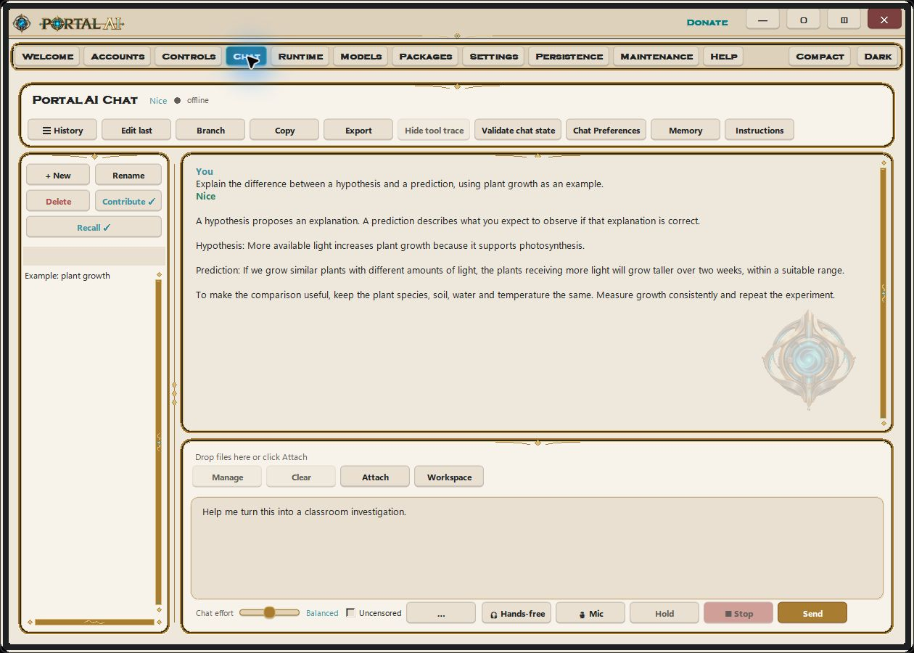
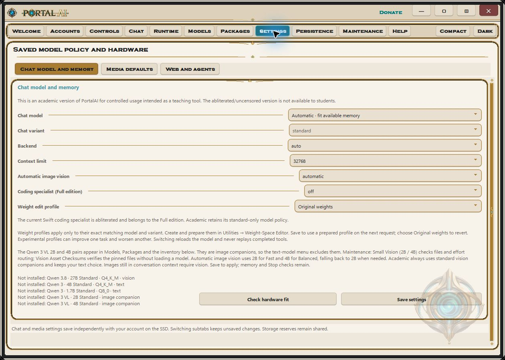
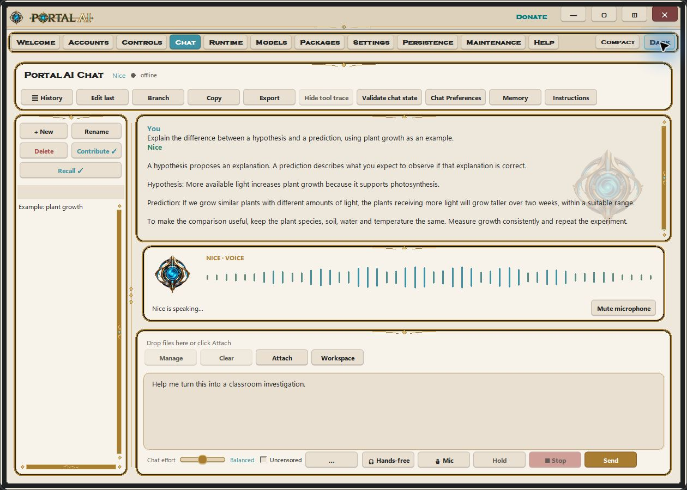
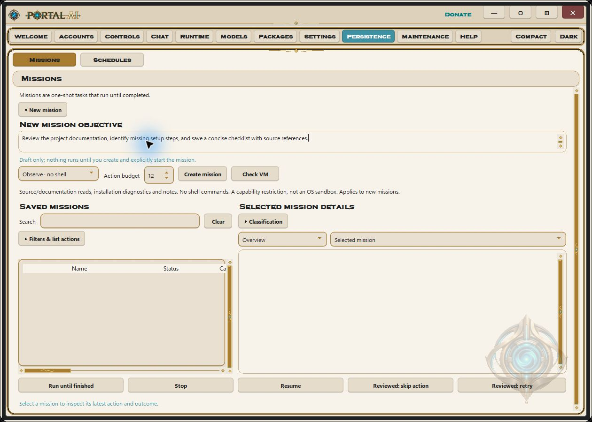
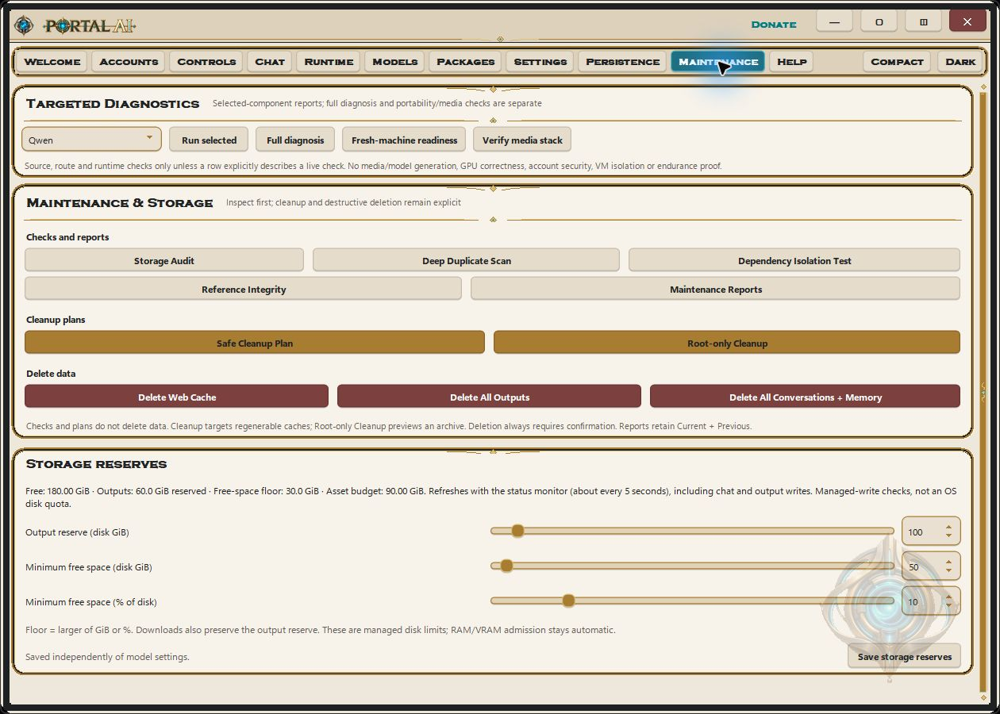
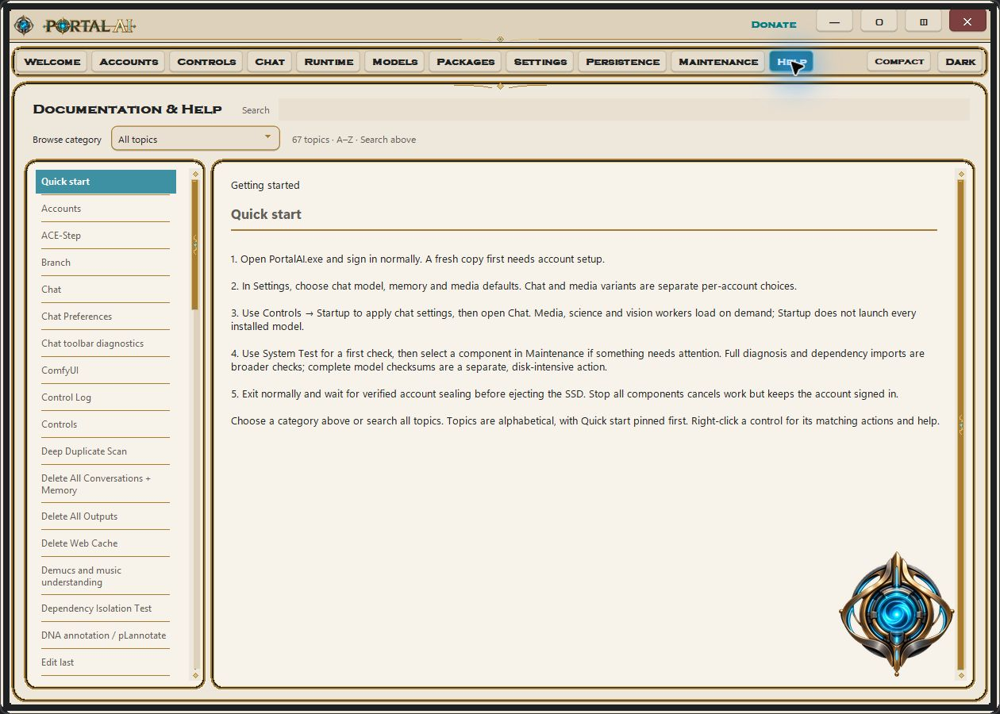
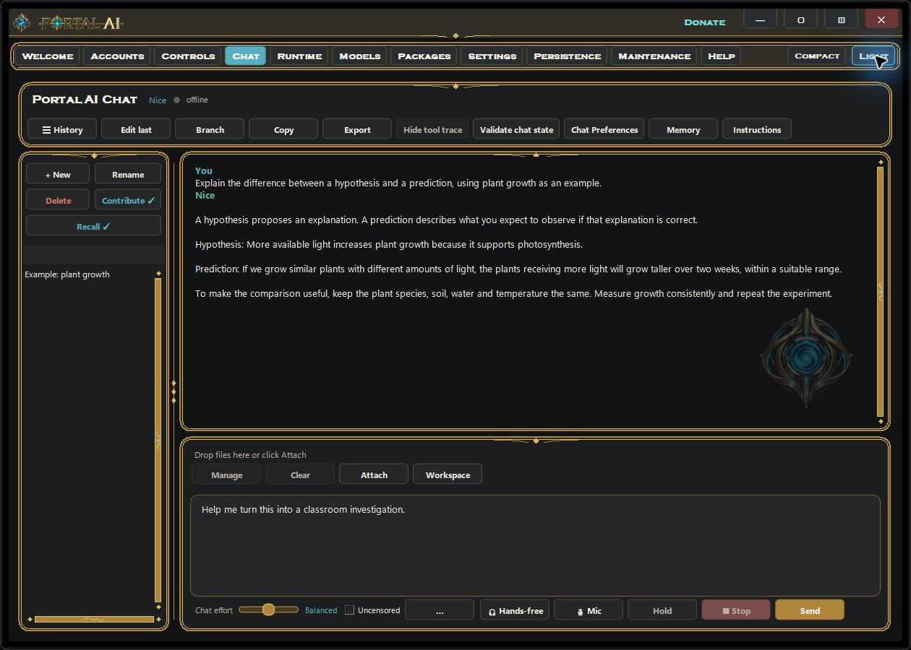
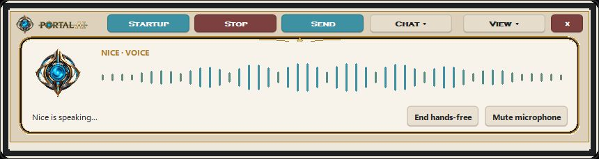

  
  &nbsp;&nbsp;
  

<h1 align="center">PortalAI Academic</h1>

<strong>Local AI for guided learning and classroom exploration.</strong>

Academic uses standard-only chat, vision and media. Full-only model assets and Portable Abliterator are excluded. It has no Full trial timer. [Edition details](Documentation/README.txt) · [Full edition](https://payhip.com/b/Kw54p) · [Try Full](https://payhip.com/b/ZeB0k).

## Download and install

**Choose one complete bundle.** It includes the native installer and compatible optional utilities. Utilities remain optional to install, configure and use; they are not activated by downloading the bundle.

<table>
<tr>
<td align="center" width="50%"> <strong>Windows x64 · r85</strong> Optional Projection and Home Assistant setup included.</td>
<td align="center" width="50%"> <strong>Mac · experimental r75</strong> Apple silicon / Intel. Optional Projection requires macOS 14+.</td>
</tr>
<tr>
<td align="center" width="50%"> <strong>Linux x86-64 · experimental r75</strong> Optional Projection and Home Assistant setup included.</td>
<td align="center" width="50%"> <strong>All three OSes · Windows r85 + Mac/Linux r75</strong> All native installers and their optional utilities in one download.</td>
</tr>
</table>

[Windows](https://github.com/Zhandragon/PortalAI-Academic/releases/download/v2026.11.25-bundle4/PortalAI-Academic-Windows-Bundle-2026.11.25-bundle4.zip) · [Mac](https://github.com/Zhandragon/PortalAI-Academic/releases/download/v2026.11.25-bundle4/PortalAI-Academic-Mac-Bundle-2026.11.25-bundle4.zip) · [Linux](https://github.com/Zhandragon/PortalAI-Academic/releases/download/v2026.11.25-bundle4/PortalAI-Academic-Linux-Bundle-2026.11.25-bundle4.zip) · [All three OSes](https://github.com/Zhandragon/PortalAI-Academic/releases/download/v2026.11.25-bundle4/PortalAI-Academic-Universal-Bundle-2026.11.25-bundle4.zip) · [Checksums](https://github.com/Zhandragon/PortalAI-Academic/releases/download/v2026.11.25-bundle4/SHA256SUMS.txt)

1. **Prepare the drive:** NTFS for Windows, APFS for Mac, or executable ext4 for Linux. [Requirements and drive preparation](Documentation/INSTALLATION.md).
2. **Extract the entire bundle** into a new folder. Keep its files together. Open **Start Setup.cmd** on Windows, **Start Setup.command** on Mac, or run **bash prepare-setup.sh** on Linux.
3. **Choose the installation root and components.** Setup suggests the drive root. Applications use **PortalAI Windows**, **PortalAI Mac** or **PortalAI Linux** there, with selected companions in the sibling **Utilities** folder. **All components** selects the complete Windows catalog; **Express** stays lightweight. Models download during setup.

**Already installed?** Exit PortalAI normally, then choose **Update existing** on Windows or use the native **--upgrade** workflow on Mac/Linux. [Setup, optional utilities and upgrades](Documentation/CURRENT-DOWNLOADS.md).

**Platform status:** Windows has received extensive runtime testing. Mac and Linux remain experimental r75, with fewer validated features than Windows r85. Universal includes separate installers; each OS needs its own native installation. Windows installers are unsigned. See [requirements and known limitations](Documentation/INSTALLATION.md).

## Latest update — November 25, 2026

**Bundle 4 — drive-root installation and complete model downloads:** choose the installation root before setup. The installed application and optional utilities follow the existing drive layout, independent of where you unzip the bundle. The model catalog now includes the additional eligible large-model variants and supporting files. Models remain optional downloads; the Windows extraction-path fix is retained. Application versions remain Windows **r85** and experimental Mac/Linux **r75**.

[Current release details](Documentation/CURRENT-DOWNLOADS.md) · [Release history and tracked changes](Documentation/RELEASE-HISTORY.md)

## What you can do

PortalAI keeps supported chat, tools, science, images, video, speech and music on your own host. Models, saved projects and accounts can travel on a suitable external SSD or USB drive. Installation needs internet; supported local workflows can run offline afterward. Optional web tools and Home Assistant use your chosen network.

- **Hardware-aware models:** load and offload supported models as needed, with manual model and backend controls.
- **Long tasks and saved missions:** compact working context, retain searchable history, and explicitly enable missions or scheduled work.
- **Local accounts:** password-protected user vaults seal on normal Exit; Guest remains shared.
- **A flexible interface:** full or compact chat, hands-free voice, built-in Help and context-aware right-click actions.

[Feature tour and science examples](Documentation/FEATURE-TOUR.md) · [Help and documentation](Documentation/README.md)

## A look inside

Interface examples captured November 8, 2026. Click any image to inspect it.

| Chat and voice | Models and workspace |
| --- | --- |
|  |  |
| Nice’s chat workspace, with an illustrative conversation. | Academic settings: standard models; Full-only coding specialist stays off. |
|  |  |
| Hands-free voice controls and visible activity. | Save objectives with access limits and action budgets. |
|  |  |
| Diagnostics, storage reserves and repair controls. | The in-app Help browser, with 67 topics. |
|  |  |
| A quieter palette for the same workspace. | Collapse the interface while keeping Nice close. |

[Full feature tour and science examples](Documentation/FEATURE-TOUR.md) · [Capture notes](Documentation/assets/README.md)

Screenshots show real r72 widgets in an isolated preview. Chat text and voice activity are illustrative; no inference or microphone recording occurred. The mission is an unexecuted draft. Platform features depend on installed components. The science examples linked below are actual Nice runs, distinct from the illustrative chat/voice preview.

## Projection and Home Assistant

Projection and **Home Assistant 0.5.13 + Recovery 0.1.0** setup are included in each OS bundle. Open them only if you want remote access. Select your installed PortalAI folder, configure your own connection, and approve pairing in Home Assistant. AI inference remains on the PortalAI host.

[Optional Projection setup and pairing](Documentation/PROJECTION.md) · [Voice integration and validation limits](Documentation/RELEASE-HA-0.5.13.md)

## Companion utilities

| Optional companion | Where to find it |
| --- | --- |
| Projection | **Utilities / your OS / PortalAI-Projection** in the bundle. |
| Home Assistant setup | The adjacent **PortalAI HA Setup** folder; keep both folders together. |
| Recovery/reset and Weight-Space Editor | In the installed application’s Utilities where supported. |

Academic excludes Portable Abliterator and Full-only model assets. Models and companions remain optional. Windows **All components** selects every available choice; **Express** selects a small starter configuration. Downloading the bundle does not install or activate a companion, pair a device, or configure Home Assistant.

## Built-in help and documentation

Open **Help** inside PortalAI or right-click a control for its relevant help topic. Use [current downloads](Documentation/CURRENT-DOWNLOADS.md), [installation requirements](Documentation/INSTALLATION.md) or the [documentation index](Documentation/README.md). Report issues to [the maintainer](https://github.com/Zhandragon/PortalAI-Academic/issues) with the OS, release and exact error, leaving out private data.

## Privacy and local accounts

This repository provides the public Academic installer distribution. Recipients create their own PortalAI accounts and Projection pairings; the download is not a copy of the maintainer's active personal workspace.

Password-protected accounts encrypt stored user vaults. Files are decrypted while that account is in use and sealed on normal **Exit PortalAI**. **Minimize to tray** and **Stop projection** do not sign out or seal the workspace. Guest is shared, and unlocked data remains accessible to software with the same operating-system access. Keep the host and drive available until shutdown completes.

## Antivirus and the llama.cpp server

Antivirus software may flag or quarantine PortalAI's llama.cpp local model server (`llama-server.exe` on Windows), its supporting libraries, bundled runtimes or the unsigned launcher. This can prevent chat models or workflows from starting and cause local server connection errors. A detection is not by itself proof of either malware or a false positive.

Check the blocked file's path and detection name, verify its source and expected SHA-256 checksum, and review the alert before restoring it or approving a specific file exception. Students should ask their instructor or IT administrator to review the alert. Do not disable antivirus globally or exclude the entire PortalAI folder. Include the antivirus product and detection name in a report to the maintainer, without submitting private data.

## Source, licensing and release history

Browse the [application source map](Documentation/SOURCE-MAP.md), [installer sources](InstallerSources/) and [utility sources](Utilities/). Each native installer retains its version and verification records. [Bundle contents and verification](Documentation/CURRENT-DOWNLOADS.md) cover this refresh.

Older patch announcements, release notes and validation records are in [release history](Documentation/RELEASE-HISTORY.md). PortalAI’s [license](LICENSE) and bundled third-party runtime/model licenses continue to apply.

 <a href="Documentation/DONATIONS.md">Support PortalAI development</a>

